# Real-Time Event driven Data Ingestion from Google Cloud Storage to Snowflake using Snowpipe


## Architecture

```mermaid
flowchart LR
    SRC["📄 Source System / User"] -->|"1. Upload file"| GCS

    subgraph GCP["☁️ Google Cloud Platform"]
        direction TB
        GCS[("🪣 GCS Bucket")]
        TOPIC["📢 Pub/Sub Topic"]
        SUB["📬 Pub/Sub Subscription"]
        GCS -->|"2. OBJECT_FINALIZE event<br/>(Bucket Notification)"| TOPIC
        TOPIC -->|"3. Publish message"| SUB
    end

    subgraph SF["❄️ Snowflake"]
        direction TB
        NI["🔔 Notification Integration"]
        PIPE["⚙️ Snowpipe<br/>AUTO_INGEST = TRUE"]
        STAGE["📂 External Stage"]
        SI["🔐 Storage Integration<br/>(Snowflake-managed Service Account)"]
        TBL[("🗄️ Target Table")]
        NI -->|"5. Trigger ingestion"| PIPE
        PIPE -->|"6. Locate new file"| STAGE
        STAGE -.->|"uses"| SI
        PIPE -->|"8. COPY INTO"| TBL
    end

    SUB -->|"4. Event notification"| NI
    SI -->|"7. Secure read (IAM-governed)"| GCS

    classDef gcp fill:#E8F0FE,stroke:#4285F4,stroke-width:2px,color:#000
    classDef snow fill:#E3F6FD,stroke:#29B5E8,stroke-width:2px,color:#000
    classDef src fill:#FFF4E5,stroke:#FB8C00,stroke-width:2px,color:#000
    class GCS,TOPIC,SUB gcp
    class NI,PIPE,STAGE,SI,TBL snow
    class SRC src
```



## Project Overview

This project demonstrates a fully automated, event-driven data ingestion pipeline that loads files from Google Cloud Storage (GCS) into Snowflake in near real-time using Snowpipe and Google Pub/Sub.

The objective is to eliminate manual data loading processes and build a scalable ingestion framework where files are automatically detected and loaded into Snowflake tables with minimal latency.

---

## Architecture Flow

```text
Object upload to Google Cloud Storage
          |
          v
Event info gets published to Pub/Sub Topic
          |
          v
Snowlfake's integration to Pub/Sub topic (Subscription) acts as the trigger to start ingesting the newly uploaded data
          |
          v
 Snowflake Notification Integration
          |
          v
Snowpipe pulls data from GCS using it's storage bucket integration
          |
          v
Snowflake Target Table
```

---

## Solution Components

### 1. Storage Integration between Snowflake and GCS

A Storage Integration is established to provide secure and controlled access from Snowflake to Google Cloud Storage.

Instead of using access keys directly, Snowflake generates a service account that is granted permissions on the target GCS bucket. This allows Snowflake to securely read files stored in the bucket while maintaining centralized access management.

**Purpose**
- Secure connectivity between Snowflake and GCS
- Eliminate credential management inside Snowflake
- Enable external data access through governed permissions

---

### 2. Google Pub/Sub Topic Configuration

A Pub/Sub topic is created to act as the event communication layer between Google Cloud Storage and Snowflake.

Whenever a new file is uploaded to the storage bucket, a notification message is published to this topic, making the architecture event-driven rather than relying on periodic polling.

**Purpose**
- Capture file arrival events in real time
- Reduce latency in data ingestion
- Enable scalable event-based processing

---

### 3. Bucket Notification Subscription

The GCS bucket is configured to publish object creation events to the Pub/Sub topic.

This ensures that every time a file is added to the bucket, an event notification is automatically generated and delivered through Pub/Sub.

**Purpose**
- Detect new file arrivals automatically
- Eliminate manual triggers
- Establish automated communication between storage and downstream systems

---

### 4. Snowflake Notification Integration

A Notification Integration is created in Snowflake to subscribe to messages generated by the Pub/Sub service.

This integration enables Snowflake to listen for file arrival notifications and trigger ingestion workflows without requiring external orchestration tools.

**Purpose**
- Connect Snowflake with Pub/Sub
- Receive event notifications in real time
- Enable automatic Snowpipe execution

---

### 5. External Stage Creation

An External Stage is configured in Snowflake to represent the location of files stored in the GCS bucket.

The stage serves as a reference point from which Snowpipe can access and load incoming files.

**Purpose**
- Abstract external storage locations
- Enable direct access to source files
- Serve as the data source for Snowpipe ingestion

---

### 6. Snowpipe Auto-Ingest Configuration

Snowpipe is configured with Auto-Ingest enabled to continuously monitor incoming file notifications.

When a new file arrives in the bucket:
1. GCS generates an object creation event.
2. Pub/Sub publishes the notification.
3. Snowflake receives the message through the Notification Integration.
4. Snowpipe identifies the new file in the external stage.
5. Data is automatically loaded into the target Snowflake table.

This creates a fully automated ingestion process without manual intervention.

**Purpose**
- Near real-time data loading
- Automated ingestion workflow
- Reduced operational
